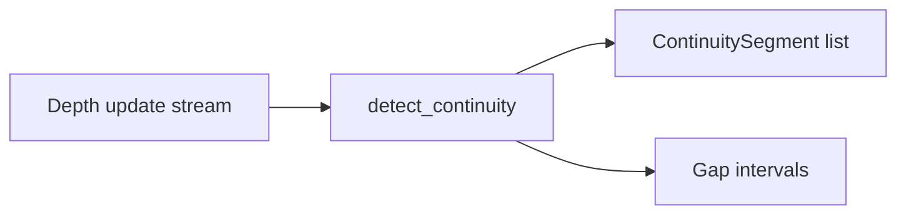

# lob-continuity

A validity framework for detecting silent continuity gaps in limit order
book reconstruction.

## Why this exists

Depth-update streams (e.g. exchange WebSocket feeds) can silently drop
messages. A naively reconstructed order book keeps looking valid after a
drop — it just becomes wrong. `lob-continuity` detects breaks in
sequence-ID continuity and marks the resulting segments, rather than
interpolating across them. See [docs/why_validity_matters.md](docs/why_validity_matters.md)
for the full argument.

## Architecture



## Quickstart

```bash
pip install -e ".[dev]"
python examples/demo.py
```

The demo generates a deterministic synthetic stream, inserts two declared
sequence gaps, and prints the segments and gaps found by the detector. The
package contains no captured market data or venue-specific calibration.

## Public API

- `detect_continuity()` scans any iterable whose events expose
  `first_update_id` and `final_update_id`.
- `ContinuityReport` returns immutable tuples of continuous segments and
  explicit gaps.
- `simulate_depth_updates()` creates deterministic synthetic fixtures for
  teaching, tests, and examples.

Malformed, overlapping, and out-of-order input fails closed with `ValueError`.
Ordering and de-duplication remain the caller's responsibility.

## Status

Version 0.1 provides the continuity detector, synthetic simulator, executable
demo, strict typing, and unit coverage. The scope stops at validity boundaries;
it does not perform reconstruction, forecasting, or market interpretation.

## License

MIT, see [LICENSE](LICENSE).
